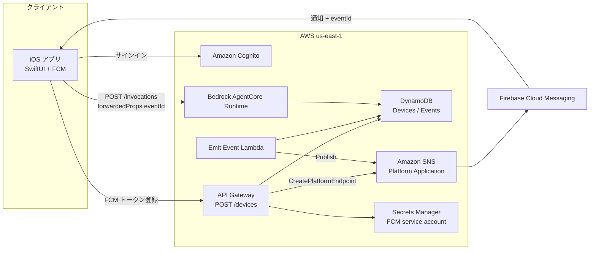
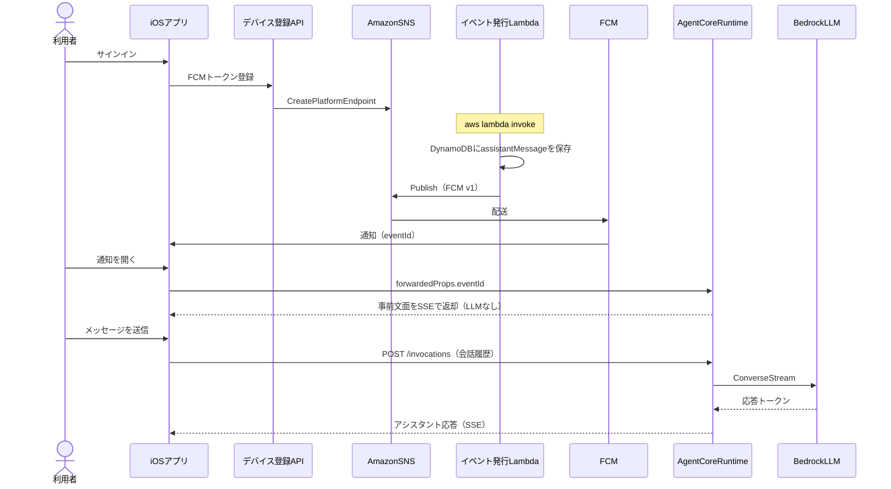

# プッシュ起点のエージェント会話サンプル

Amazon Bedrock AgentCore Runtime 上のエージェントと、
iOS アプリからチャットするサンプルである。
クラウドで発生したイベントを Amazon SNS 経由で FCM に送る。
通知を開いた端末がエージェントへ接続すると、
DynamoDB に保存したアシスタント文面が SSE で表示される。

## サンプルの概要

確認できること:

- Cognito ユーザー名 / パスワードによるサインイン
- FCM トークンの登録と Amazon SNS プラットフォームエンドポイントの作成
- クラウドイベント発行から FCM 通知までの流れ
- 通知をきっかけにしたエージェント起点の会話（SSE）
- イベント発行時に表示文面を DynamoDB へ保存し、通知タップ時は LLM なしで即時表示
- ユーザーが入力したメッセージには GPT-6 Luna で応答する

| 項目 | 内容 |
| --- | --- |
| クライアント | SwiftUI（iOS 17 以上） |
| バックエンド | Bedrock AgentCore Runtime（コンテナ実行） |
| プッシュ | Amazon SNS → Firebase Cloud Messaging（HTTP v1） |
| エージェント | Python 3.12 / Strands Agents / FastAPI |
| モデル | `us.openai.gpt-6-luna`（GPT-6 Luna。ユーザー入力への応答に使用） |
| 通信 | Runtime の invocations API（SSE） |
| 認証 | Amazon Cognito（JWT Bearer） |
| リージョン | `us-east-1` |
| IaC | AWS CDK（TypeScript） |

ディレクトリ構成:

```text
push-event/
├── agent/          # Runtime に載せるエージェント
├── infra/          # CDK（Cognito / Runtime / DynamoDB / API / SNS 連携）
│   ├── lambdas/    # デバイス登録・イベント発行
│   └── policies/   # 実行ロール参考ポリシー
└── ios/            # SwiftUI チャットアプリ
```

### 前提条件

- Node.js 20 以上と pnpm
- Docker（ARM64 イメージのビルド）
- AWS CLI（デプロイ先アカウントへ認証済み、`us-east-1`）
- Xcode 16 以上（iOS クライアント）
- 実機プッシュ確認用の Apple Developer Program（有料）と Firebase プロジェクト
- Bedrock で GPT-6 Luna（`us.openai.gpt-6-luna`）を利用できること

## アーキテクチャ

### 構成図



主なコンポーネント:

| コンポーネント | 役割 |
| --- | --- |
| Cognito User Pool | デモユーザーの認証 |
| Devices API | FCM トークンを受け取り、SNS エンドポイントを作成する |
| Events テーブル | 未配送 / 配送済みのイベントと表示用文面を保持する |
| Emit Event Lambda | イベント保存（`assistantMessage` 含む）と SNS Publish |
| SNS Platform Application | FCM HTTP v1 へ配送する（初回デバイス登録時に作成） |
| AgentCore Runtime | 通知タップ時は DynamoDB の文面を返し、ユーザー入力には LLM で応答する |
| iOS アプリ | ログイン、端末登録、通知受信、チャット表示 |

### シーケンス図



## 事前準備

### 1. バンドル ID を決める

Apple Developer 全体で一意なバンドル ID を決める。
次をすべて同じ値にする。

- Xcode の `PRODUCT_BUNDLE_IDENTIFIER`
- Apple Developer の App ID
- Firebase の iOS アプリ
- `simulator-push.apns` の `Simulator Target Bundle`
- Keychain の service 名（`KeychainStore.swift`）

### 2. Apple Developer

1. [Apple Developer](https://developer.apple.com/account) にサインインする（有料プログラム）
2. Certificates, Identifiers & Profiles → Identifiers で App ID を登録する
   - Bundle ID: 手順 1 と同じ明示的 ID（Wildcard 不可）
   - Capabilities で Push Notifications を有効にする
3. Keys で APNs 用の鍵を作成する
   - Apple Push Notifications service (APNs) にチェックする
   - `.p8` をダウンロードする（再ダウンロード不可）
   - Key ID と Team ID を控える

### 3. Firebase

1. [Firebase Console](https://console.firebase.google.com/) でプロジェクトを作成する
2. iOS アプリを追加する（Apple bundle ID は手順 1 と同じ）
3. `GoogleService-Info.plist` をダウンロードする
4. Project settings → Cloud Messaging → Apple app configuration で
   APNs 認証キー（`.p8`）、Key ID、Team ID を登録する
5. Project settings → Service accounts → Generate new private key で
   サービスアカウント JSON をダウンロードする（例: `service-account.json`）
6. Cloud Messaging API が無効なら、Google Cloud Console で有効にする

### 4. iOS プロジェクトへ反映する

1. `GoogleService-Info.plist` を `ios/PushEventChat/GoogleService-Info.plist` に置く
2. Xcode の Signing & Capabilities で次を設定する
   - Team: 手順 2 のチーム
   - Bundle Identifier: 手順 1 と同じ
   - Push Notifications
   - Background Modes → Remote notifications
3. 実機を選んでビルドする

次のファイルはリポジトリにコミットしない。

- `GoogleService-Info.plist`
- `service-account.json` / `*-firebase-adminsdk-*.json`
- `AuthKey_*.p8`

## デプロイの手順

### 1. AWS 認証

```bash
export AWS_DEFAULT_REGION=us-east-1
export CDK_DEFAULT_REGION=us-east-1
aws sts get-caller-identity
```

### 2. CDK デプロイ

```bash
cd push-event/infra
pnpm install
pnpm exec cdk bootstrap aws://<ACCOUNT_ID>/us-east-1   # 初回のみ
pnpm exec cdk deploy
```

デプロイ後、次の出力を控える。

- `AgentRuntimeArn`
- `UserPoolId`
- `UserPoolClientId`
- `DevicesApiUrl`
- `EmitEventFunctionName`
- `EventsTableName`
- `FcmSecretArn`
- `AwsRegion`

### 3. FCM サービスアカウントを Secrets Manager に登録

```bash
aws secretsmanager put-secret-value \
  --region us-east-1 \
  --secret-id <FcmSecretArn> \
  --secret-string file://service-account.json
```

`service-account.json` は Firebase のサービスアカウント秘密鍵である。
少なくとも `project_id` と `private_key` を含む JSON を Secrets Manager に格納する。

デバイス登録 API は、初回呼び出し時に SNS プラットフォームアプリケーションを作成する
（`Platform=GCM`。サービスアカウント JSON を `PlatformCredential` に渡す）。

シークレットを更新しても、すでに作られた SNS プラットフォームアプリケーションは
自動では追随しない。更新後に届かない場合は、SSM パラメータ
（スタックの Platform Application パラメータ）と SNS の
Platform Application / Endpoint を削除し、端末から再登録する。

### 4. Cognito ユーザー作成

パスワードは例である。運用に合わせて変更する。

```bash
aws cognito-idp admin-create-user \
  --region us-east-1 \
  --user-pool-id <UserPoolId> \
  --username demo \
  --temporary-password 'TempPass1!' \
  --message-action SUPPRESS

aws cognito-idp admin-set-user-password \
  --region us-east-1 \
  --user-pool-id <UserPoolId> \
  --username demo \
  --password 'DemoPass1!' \
  --permanent
```

### 5. iOS 設定の反映

[`ios/PushEventChat/Config.swift`](ios/PushEventChat/Config.swift) に CDK 出力を設定する。

```swift
static let awsRegion = "us-east-1"
static let userPoolId = "REPLACE_USER_POOL_ID"
static let userPoolClientId = "REPLACE_USER_POOL_CLIENT_ID"
static let agentRuntimeArn = "REPLACE_AGENT_RUNTIME_ARN"
static let devicesApiUrl = "REPLACE_DEVICES_API_URL"
```

`GoogleService-Info.plist` をターゲットに追加済みであることを確認する
（手順「事前準備」参照）。

## 実行方法

### iOS アプリ（実機）

1. Xcode で [`ios/PushEventChat.xcodeproj`](ios/PushEventChat.xcodeproj) を開く
2. Signing の Team / Bundle ID を確認し、実機を選んで実行する
3. Cognito ユーザーでサインインする（端末登録が走る）
4. 別ターミナルでイベントを発行する（次節）
5. 通知を開き、アシスタント発話（事前文面）が表示されることを確認する

CLI でのビルド確認:

```bash
cd push-event/ios
xcodebuild \
  -project PushEventChat.xcodeproj \
  -scheme PushEventChat \
  -destination 'platform=iOS Simulator,name=iPhone 17' \
  -derivedDataPath build \
  CODE_SIGNING_ALLOWED=NO \
  build
```

### iOS シミュレータでの通知確認

シミュレータは FCM / APNs を受け取れない。
代わりに [`ios/simulator-push.apns`](ios/simulator-push.apns) を送り、
通知タップ後のエージェント接続を確認する。

1. DynamoDB の Events テーブルに、`.apns` と同じ `eventId` の未配送イベントを置く
   （`assistantMessage` も含める）
2. アプリを起動し、サインインする
3. 通知許可を許可する
4. 次のいずれかで通知を送る

```bash
cd push-event/ios
xcrun simctl push booted com.example.PushEventChat simulator-push.apns
```

または、`simulator-push.apns` をシミュレータ画面へドラッグする
（ファイル内の `Simulator Target Bundle` が必要である）。

フォアグラウンドでもバナーが出る。
`eventId` を受け取ると、ユーザー吹き出しなしでアシスタント文面が表示される。

### イベント発行

```bash
aws lambda invoke \
  --region us-east-1 \
  --function-name <EmitEventFunctionName> \
  --cli-binary-format raw-in-base64-out \
  --payload '{
    "username": "demo",
    "title": "会議のリマインダー",
    "body": "15分後に週次ミーティングが始まります。準備は大丈夫ですか？"
  }' \
  /tmp/emit-event-out.json

cat /tmp/emit-event-out.json
```

通知のタイトルは「エージェント」、本文は `title` である。
チャットに出す文面は発行時に `assistantMessage` として保存され、
通知タップ時にエージェントが DynamoDB から返す（LLM 呼び出しなし）。

### ローカルでのエージェント単体確認

```bash
cd push-event/agent
python3.12 -m venv .venv
source .venv/bin/activate
pip install -r requirements.txt
export AWS_REGION=us-east-1
export BEDROCK_MODEL_ID=us.openai.gpt-6-luna
export EVENTS_TABLE=<EventsTableName>
python app.py
```

## 後片付けの手順

1. Cognito デモユーザーが不要なら削除する（任意）
2. CDK スタックを削除する

   ```bash
   cd push-event/infra
   pnpm exec cdk destroy
   ```

3. 残存リソースを確認する

   - SNS プラットフォームアプリケーション / エンドポイント
     （スタック外で作成される場合がある）
   - SSM の Platform Application パラメータ
   - ECR に CDK アセット用リポジトリが残る場合がある
   - CloudWatch Logs（`/aws/bedrock-agentcore/runtimes/*`）
   - Secrets Manager の FCM サービスアカウント
   - Marketplace 購読はアカウント単位のため、不要なら
     AWS Marketplace コンソールから解除する

4. iOS の `Config.swift` と `GoogleService-Info.plist` を
   リポジトリ公開前の状態（プレースホルダ / 未配置）に戻す（任意）

ローカル成果物の削除例:

```bash
rm -rf push-event/infra/cdk.out
rm -rf push-event/ios/build
rm -rf push-event/agent/.venv
```
