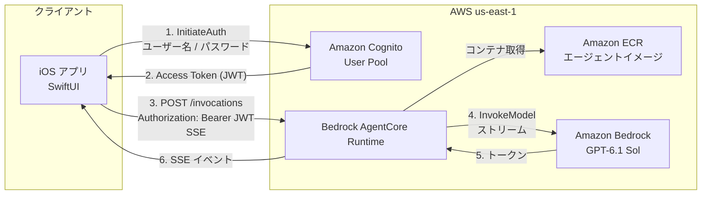
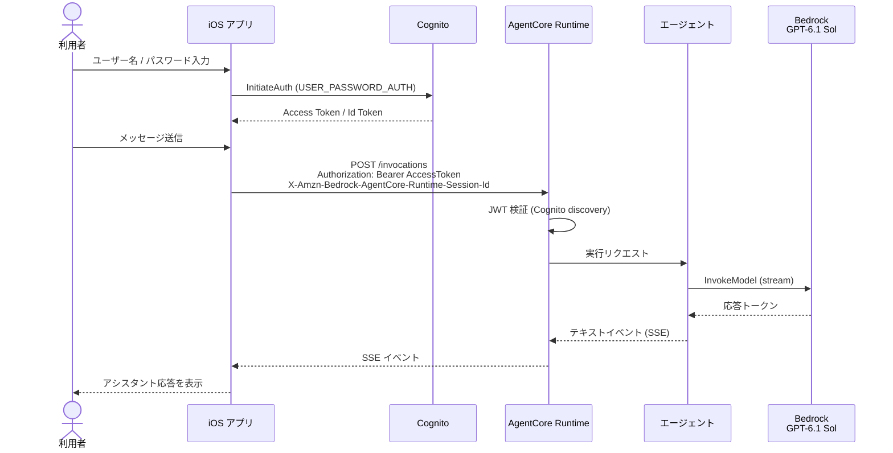

# AgentCore Runtime チャット（シンプル iOS アプリ）

Amazon Bedrock AgentCore Runtime 上で動作するエージェントと、
iOS アプリからチャットする最小構成のサンプルです。

## サンプルの概要

本サンプルの意図は、AgentCore Runtime にデプロイしたエージェントへ
認証付きで接続し、iOS から会話できる流れを示すことです。

確認できること:

- Cognito ユーザー名 / パスワードによるサインイン
- AgentCore Runtime への JWT 付き呼び出し
- ストリーミング応答のチャット表示

| 項目 | 内容 |
| --- | --- |
| クライアント | SwiftUI（iOS 17 以上） |
| バックエンド | Bedrock AgentCore Runtime（コンテナ実行） |
| エージェント | Python 3.12 / Strands Agents / FastAPI |
| モデル | `us.openai.gpt-6.1-sol`（GPT-6.1 Sol） |
| 通信 | Runtime の invocations API（SSE） |
| 認証 | Amazon Cognito（JWT Bearer） |
| リージョン | `us-east-1` |
| IaC | AWS CDK（TypeScript） |

ディレクトリ構成:

```text
simple/
├── agent/          # Runtime に載せるエージェント
├── infra/          # CDK（Cognito + AgentCore Runtime）
│   └── policies/   # 最小権限ポリシー（SCP / 実行ロール参考）
└── ios/            # SwiftUI チャットアプリ
```

### 前提条件

- Node.js 20 以上と pnpm
- Docker（ARM64 イメージのビルド）
- AWS CLI（デプロイ先アカウントへ認証済み、`us-east-1`）
- Xcode 16 以上（iOS クライアント）
- Bedrock で GPT-6.1 Sol（`us.openai.gpt-6.1-sol`）を利用できること
- Organizations SCP で `bedrock-agentcore:*` が拒否されていないこと

GPT-6.1 Sol は Marketplace 経由の第三者モデルです。
初回利用時はアカウント側で Marketplace 購読が必要です
（従量課金。本サンプルの実行ロールに購読用 IAM を付与済み）。

## アーキテクチャ

### 構成図



主なコンポーネント:

| コンポーネント | 役割 |
| --- | --- |
| Cognito User Pool | デモユーザーの認証。アプリは Access Token を保持する |
| AgentCore Runtime | エージェントコンテナを実行し、JWT を検証する |
| エージェントコンテナ | Strands + Bedrock で応答を生成し、SSE で返す |
| iOS アプリ | ログイン、チャット送信、応答の描画 |

実行ロールは当該 ECR イメージ取得、指定モデルの呼び出し、
ログ / メトリクス、Marketplace 購読 API に限定しています。

参考ポリシー:

- [実行ロール最小権限 JSON](infra/policies/agentcore-runtime-execution-minimal.json)

### シーケンス図



チャット送信時の要点:

1. Cognito で取得した Access Token を `Authorization` に付与する
2. AgentCore はセッション ID（33 文字以上）をヘッダで要求する
3. 応答は SSE のテキストイベントとして届く

## デプロイの手順

### 1. AWS 認証

デプロイ先アカウントで `us-east-1` に対する認証情報を用意します。
プロファイルに `mfa_serial` がある場合は、対話待ちを避けるため
一時認証情報をエクスポートしてから CDK を実行してください。

```bash
export AWS_DEFAULT_REGION=us-east-1
export CDK_DEFAULT_REGION=us-east-1
aws sts get-caller-identity
```

Organizations SCP で AgentCore が拒否されている場合は、
次のポリシー案を参考に例外を追加します。

- [SCP 例外ポリシー案](infra/policies/scp-allow-agentcore-minimal.json)

### 2. CDK デプロイ

```bash
cd simple/infra
pnpm install
pnpm exec cdk bootstrap aws://<ACCOUNT_ID>/us-east-1   # 初回のみ
pnpm exec cdk deploy
```

デプロイ後、次の出力を控えます。

- `AgentRuntimeArn`
- `UserPoolId`
- `UserPoolClientId`
- `AwsRegion`
- `BedrockModelId`

### 3. Cognito ユーザー作成

```bash
aws cognito-idp admin-create-user \
  --region us-east-1 \
  --user-pool-id <UserPoolId> \
  --username demo \
  --temporary-password 'TempPass1!' \
  --message-action SUPPRESS

aws cognito-idp admin-set-user-password \
  --region us-east-1 \
  --user-pool-id <UserPoolId> \
  --username demo \
  --password 'DemoPass1!' \
  --permanent
```

### 4. モデル利用の確認

`us-east-1` で GPT-6.1 Sol（推論プロファイル `us.openai.gpt-6.1-sol`）を
呼び出し可能であることを確認します。Marketplace 未購読の場合は、
管理者権限で一度 `bedrock:InvokeModel` / `converse` を実行すると
購読が確立されます。

### 5. iOS 設定の反映

[`ios/SimpleChat/Config.swift`](ios/SimpleChat/Config.swift) に CDK 出力を設定します。

```swift
static let awsRegion = "us-east-1"
static let userPoolId = "us-east-1_xxxxx"
static let userPoolClientId = "xxxxxxxx"
static let agentRuntimeArn = "arn:aws:bedrock-agentcore:us-east-1:ACCOUNT:runtime/..."
```

## 実行方法

### iOS アプリ

1. Xcode で [`ios/SimpleChat.xcodeproj`](ios/SimpleChat.xcodeproj) を開く
2. Signing & Capabilities で Development Team を設定する
3. シミュレータまたは実機で実行する
4. Cognito ユーザーでサインインする（シミュレータでは
   Cognito で作成した `demo` ユーザーとパスワードを入力する）
5. メッセージを送信し、応答を確認する

CLI でのビルド確認:

```bash
cd simple/ios
xcodebuild \
  -project SimpleChat.xcodeproj \
  -scheme SimpleChat \
  -destination 'platform=iOS Simulator,name=iPhone 17' \
  -derivedDataPath build \
  CODE_SIGNING_ALLOWED=NO \
  build
```

Xcode 27 では従来の Simulator.app の代わりに DeviceHub で
シミュレータ画面を操作します。入力欄でソフトウェアキーボードが
出ない場合は、DeviceHub ウィンドウを前面にしてから Mac キーボードで
入力してください。チャット画面にはクイック送信ボタンもあります。

### curl での E2E 確認

```bash
TOKEN=$(aws cognito-idp initiate-auth \
  --region us-east-1 \
  --auth-flow USER_PASSWORD_AUTH \
  --client-id <UserPoolClientId> \
  --auth-parameters USERNAME=demo,PASSWORD='DemoPass1!' \
  --query 'AuthenticationResult.AccessToken' \
  --output text)

ESCAPED_ARN=$(
  python3 -c \
    "import urllib.parse,sys; print(urllib.parse.quote(sys.argv[1], safe=''))" \
    "<AgentRuntimeArn>"
)

BASE="https://bedrock-agentcore.us-east-1.amazonaws.com"
URL="${BASE}/runtimes/${ESCAPED_ARN}/invocations?qualifier=DEFAULT"
SESSION_ID="session-$(uuidgen)"

curl -N -X POST "${URL}" \
  -H "Authorization: Bearer ${TOKEN}" \
  -H "Content-Type: application/json" \
  -H "X-Amzn-Bedrock-AgentCore-Runtime-Session-Id: ${SESSION_ID}" \
  -d '{
    "threadId": "test-123",
    "runId": "run-456",
    "state": {},
    "messages": [
      {"role": "user", "content": "Reply with only OK", "id": "msg-1"}
    ],
    "tools": [],
    "context": [],
    "forwardedProps": {}
  }'
```

### ローカルでのエージェント単体確認

```bash
cd simple/agent
python3.12 -m venv .venv
source .venv/bin/activate
pip install -r requirements.txt
export AWS_REGION=us-east-1
export BEDROCK_MODEL_ID=us.openai.gpt-6.1-sol
python app.py
```

別ターミナル:

```bash
curl -N -X POST http://localhost:8080/invocations \
  -H "Content-Type: application/json" \
  -d '{
    "threadId": "test-123",
    "runId": "run-456",
    "state": {},
    "messages": [{"role": "user", "content": "Hello", "id": "msg-1"}],
    "tools": [],
    "context": [],
    "forwardedProps": {}
  }'
```

## 後片付けの手順

1. Cognito デモユーザーが不要なら削除する（任意）

   ```bash
   aws cognito-idp admin-delete-user \
     --region us-east-1 \
     --user-pool-id <UserPoolId> \
     --username demo
   ```

2. CDK スタックを削除する

   ```bash
   cd simple/infra
   pnpm exec cdk destroy
   ```

3. 残存リソースを確認する

   - ECR に CDK アセット用リポジトリが残る場合がある
   - CloudWatch Logs（`/aws/bedrock-agentcore/runtimes/*`）
   - Marketplace 購読はアカウント単位のため、不要なら
     AWS Marketplace コンソールから解除する

4. iOS の `Config.swift` をプレースホルダに戻す（任意）

ローカル成果物の削除例:

```bash
rm -rf simple/infra/cdk.out
rm -rf simple/ios/build
rm -rf simple/agent/.venv
```
